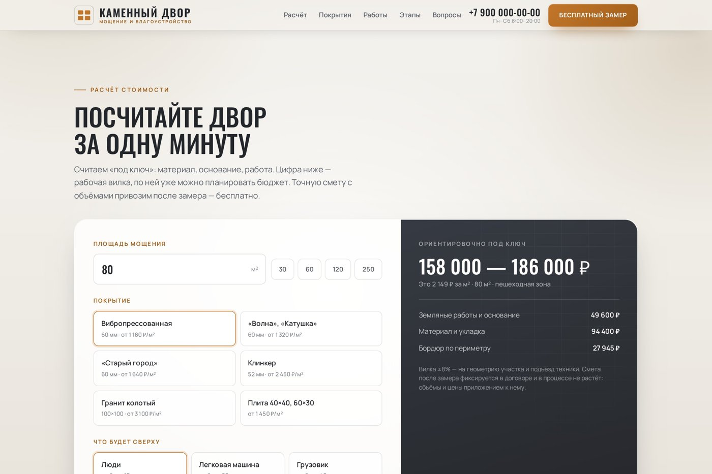
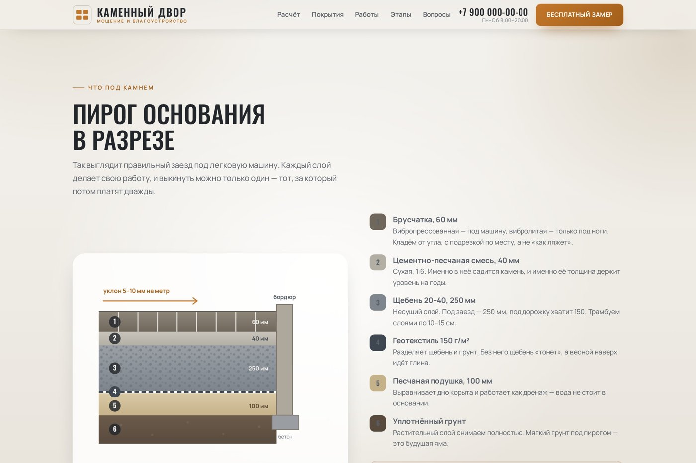
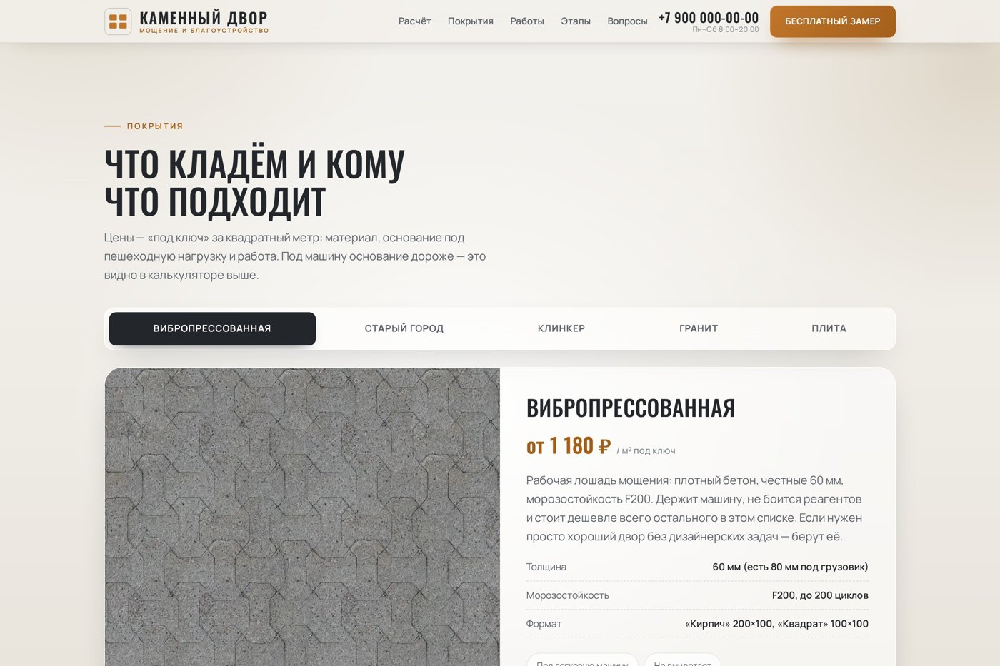
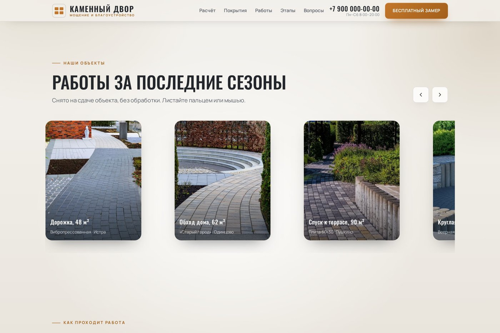

# Каменный двор — лендинг компании по укладке брусчатки

Одностраничный сайт для подрядчика по мощению и благоустройству: калькулятор стоимости «под ключ», схема основания в разрезе, каталог покрытий, портфолио и заявка прямо в Google-таблицу.

## Сайт

**Демо:** https://kamenny-dvor.netlify.app


## Для кого и какую задачу решает

Для небольшой компании или бригады, которая укладывает брусчатку и тротуарную плитку: дворы, въезды, дорожки, площадки у частных домов.

Типичная проблема такого бизнеса: клиент звонит с одним вопросом «сколько стоит?», а мастер не может ответить без замера. Половина обращений теряется на этом шаге. Лендинг закрывает его заранее:

- **клиент сам считает вилку цены** по площади, покрытию и нагрузке и видит, из чего она складывается;
- **расчёт уходит в заявку**, и мастер получает в таблице не просто телефон, а готовые параметры объекта;
- **доверие строится на деталях**: разрез «пирога» основания, толщина щебня под разную нагрузку, гарантия, реальные объекты и бригада.

## Что внутри

**Блоки страницы**

1. Первый экран: оффер, кнопки «Рассчитать стоимость» и «Смотреть работы», цифры (лет на рынке, объекты, гарантия).
2. «Почему мы»: чем отличается правильное основание от «как обычно».
3. **Калькулятор стоимости.**
4. **Пирог основания**: SVG-схема заезда под машину в разрезе — шесть слоёв от уплотнённого грунта до брусчатки с толщинами, бордюр на бетоне, уклон, пояснение к каждому слою.
5. Каталог покрытий с ценами за м²: вибропрессованная плитка, «Волна»/«Катушка», «Старый город», клинкер, гранит, крупноформатная плита.
6. Портфолио: галерея работ за последние сезоны.
7. Пять шагов работы: от замера до сдачи.
8. Отзывы заказчиков.
9. Бригада.
10. География выезда: Москва и область.
11. Частые вопросы (аккордеон).
12. Уход за покрытием после укладки.
13. Подвал с контактами, мессенджерами и закреплённая кнопка «Бесплатный замер» на телефоне.
14. Модальное окно заявки с маской телефона.

**Калькулятор**

- Площадь мощения: ввод вручную или быстрые кнопки 30 / 60 / 120 / 250 м².
- Покрытие: шесть вариантов со своей ценой за м².
- Нагрузка: люди (щебень 15 см), легковая машина (25 см), грузовик (40 см).
- Дополнительные работы: бордюр по периметру, ливневые лотки, демонтаж старого покрытия с вывозом, подогрев площадки.
- Результат: итог «под ключ» с вилкой ±8% и разбивкой по статьям (основание, материал и укладка, бордюр, водоотвод, демонтаж, подогрев).
- Кнопка «Отправить расчёт мастеру» открывает форму, и параметры расчёта уходят вместе с заявкой.

**Заявки**

Форма отправляет данные в Google Apps Script (`apps-script.gs`), скрипт сам находит или создаёт таблицу «сайт брусчатка» и пишет строку: дата, имя, телефон, объект, сроки, расчёт с сайта, комментарий, источник. По желанию дублирует заявку на почту.

## Стек

- **HTML + CSS + чистый JavaScript** в одном файле `index.html`, без фреймворков и сборки.
- **SVG**: схема основания, иконки, фавикон.
- **Google Apps Script + Google Таблицы**: приём заявок без своего сервера.
- **Шрифты** Manrope и Oswald (SIL Open Font License) подключены локально в `assets/fonts/`.
- **Фото** в формате WebP, `loading="lazy"` для галереи.
- **Хостинг**: Netlify.

```
index.html          — весь сайт: разметка, стили, скрипты
apps-script.gs      — приёмник заявок для Google Таблиц
assets/fonts/       — шрифты woff2
assets/img/         — фотографии (WebP)
images/             — скриншоты для README
```

## Скриншоты

**Калькулятор стоимости**



**Пирог основания в разрезе**



**Каталог покрытий**



**Портфолио**



**Мобильная версия**


## Как запустить и опубликовать

**Посмотреть локально.** Достаточно открыть `index.html` в браузере. Или запустить простой сервер:

```bash
python3 -m http.server 8000
# открыть http://localhost:8000
```

**Подключить свою таблицу для заявок.**

1. Открыть [script.google.com](https://script.google.com), создать проект и вставить код из `apps-script.gs`.
2. В начале файла при желании поменять название таблицы и указать почту в `NOTIFY_EMAIL`.
3. «Развернуть» → «Новое развёртывание» → «Веб-приложение», запуск от имени «Я», доступ «У всех».
4. Скопировать ссылку вида `https://script.google.com/macros/s/.../exec` и вставить её в `index.html` в константу `FORM_ENDPOINT`.

Подробная инструкция есть в комментарии в начале `apps-script.gs`.

**Опубликовать.** Сайт статический, подойдёт любой хостинг:

- **Netlify**: перетащить папку проекта на [app.netlify.com/drop](https://app.netlify.com/drop);
- **GitHub Pages**: Settings → Pages → Deploy from branch → `main`, папка `/ (root)`.

**Под своего клиента** меняются название, телефон (сейчас заглушка `+7 900 000-00-00`), цены в калькуляторе и каталоге, фото в `assets/img/`.

## Фото и лицензии

Фотографии взяты с [Pexels](https://www.pexels.com) и используются по [бесплатной лицензии Pexels](https://www.pexels.com/license/): можно использовать бесплатно, в том числе в коммерческих проектах, без обязательного указания автора. Компания, имена, отзывы и контакты на сайте вымышленные, это демонстрационный проект.

---

Разработка — вайб-кодинг в Claude Code.
